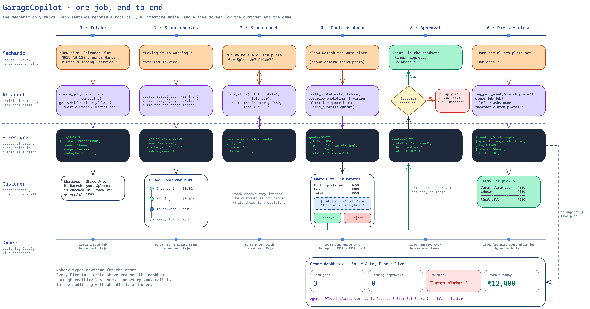
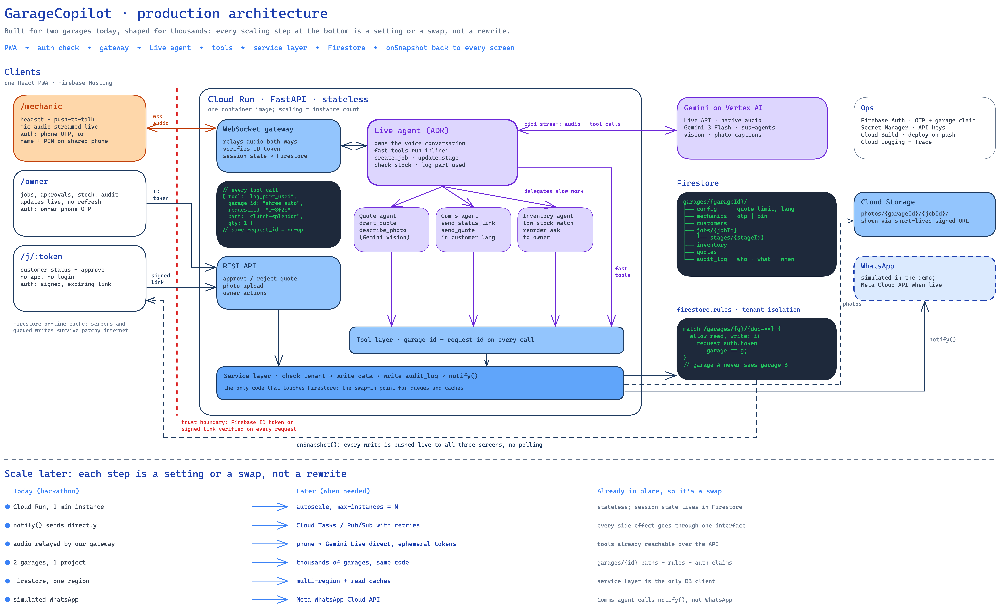

# GarageCopilot

**A voice-first AI back office for small Indian garages.**

A mechanic with greasy hands can't stop to type, call the customer or check the stock register. With GarageCopilot
they just talk through a headset, in English, Hindi, Marathi or Hinglish, and the AI does the rest. It opens the job
card, checks stock, sends the customer a quote with a photo for approval, logs the parts used and closes the bill.
The owner's dashboard and the customer's status page update live while this happens.

Built for the Google AI Builders Cup on an all-Google stack: Gemini (Live voice, vision, search), the Agent
Development Kit, Cloud Run, Firestore and Firebase.

**Try it:** <https://garagecopilot.web.app>



## The problem

India has hundreds of thousands of small two-wheeler and car garages. Most run on a notebook, a phone and memory:

- Every "do we have a clutch plate?" or "can we go ahead with the extra work?" stops the repair.
- Customers call again and again to ask if their vehicle is ready.
- The owner doesn't know what is happening on the floor, what's running low, or what the day earned.
- Software built for big service centres expects someone to sit and type. Nobody in a small garage has time for that.

## What GarageCopilot does

There are three people, and each gets their own screen. Nobody has to learn an app.

| Who | What they get |
|---|---|
| **Mechanic** | A hands-free voice assistant in the headset. They say what they're doing and it keeps the records, checks stock, answers spec questions from the vehicle's manual, and tells them when the customer approves. |
| **Owner** | A live dashboard: every vehicle on the floor (in 3D), stages, quotes waiting for approval, stock and reorder suggestions, calls and the day's earnings. They can also ask it questions by voice ("How much did we make today?"). |
| **Customer** | A private link on WhatsApp. It shows their vehicle's status live and lets them approve or reject extra work with one tap. It works in their own language and needs no login or app. They can also tap "Call the garage" to talk to an AI front desk. |

### A job, start to finish

1. **Check-in.** *"New bike, Splendor Plus, MH12 AB 1234, owner Ramesh, clutch slipping, service."* The job card is
   created, the vehicle's history comes up ("last clutch work 8 months ago"), and Ramesh gets his tracking link.
2. **Work starts.** *"Started service."* The customer page and the owner dashboard move to "In service".
3. **Stock check.** *"Do we have a clutch plate for Splendor? Price?"* → "Two in stock, ₹650, labour ₹300."
4. **Extra work needs approval.** *"Show Ramesh the worn plate."* The mechanic takes a photo. GarageCopilot writes a
   quote in Ramesh's language (Marathi) with the photo and a short description of the problem, and sends it to him.
5. **Approval.** Ramesh taps Approve on his phone. The mechanic hears *"Ramesh approved. Go ahead."*
6. **Finish.** *"Used one clutch plate set."* … *"Moving it to washing."* … *"Job done."* The stock goes down,
   the bill is made, and if a part is running low the owner is asked whether to reorder.

Nobody typed anything, and every step is recorded with who did it and when.

### Other things it does

- **Speaks the mechanic's language.** It answers in English, Hindi, Marathi or Hinglish, whichever was spoken last.
- **Answers from the manual.** Ask "spark plug gap?" or "tyre pressure?" and it answers from the vehicle's owner's
  manual and names the page. It never guesses a spec.
- **Searches the web, but only with permission.** If the manual doesn't have the answer, it asks "Shall I search
  online?" and searches only after the mechanic says yes.
- **AI front desk.** Customers can call the garage from their link or from the website. The AI tells them their
  vehicle's status, books drop-offs and takes callback requests. It never makes up a price; questions like that go
  to the owner.
- **Stays on topic.** It only helps with garage work. Off-topic requests are cut off politely.
- **Safe for voice.** A tap, silence or background noise never turns into an action, and a repeated command never
  takes a part out of stock twice.
- **Many garages, kept apart.** Each garage sees only its own data. The demo has two garages to show this.

## How to try it

### Option 1: the live app (real AI)

Open <https://garagecopilot.web.app> on a phone or laptop and allow the microphone. These demo accounts are set up:

**Garage 1: Shree Auto, Pune**

| Screen | Where | Sign in with |
|---|---|---|
| Mechanic | `/mechanic` | Garage `shree-auto` (the default), name **Raju** (or **Salim**), PIN **1234** |
| Owner | `/owner` | Phone **+91 98000 00001**, OTP **123456** (Asha, the owner) |
| Customer | link from the owner dashboard | Once a job is opened: Owner → Messages → copy the link from the WhatsApp (simulated) message to the customer and open it |

**Garage 2: Ganesh Motors, Nashik** (to see that the two garages can't see each other's data)

| Screen | Where | Sign in with |
|---|---|---|
| Mechanic | `/mechanic` | Tap "Garage" and change it to `ganesh-motors`, name **Sunil**, PIN **1234** |
| Owner | `/owner` | Phone **+91 98000 00002**, OTP **123456** (Vikram, the owner) |

The phone numbers are Firebase test numbers, so no real SMS is sent and the OTP is always `123456`. All names, phone
numbers, vehicles and customers are made-up demo data. WhatsApp messages are simulated: they show up in the owner's
Messages tab instead of being sent.

**Suggested walkthrough**

1. Open **Owner** on a laptop and **Mechanic** on a phone (a headset helps).
2. On the mechanic screen, say the lines from "A job, start to finish" above. The owner dashboard updates as you
   speak.
3. When the quote is sent, copy the customer link from Owner → Messages and open it on another phone or tab. Approve the quote and
   listen for "approved" in the mechanic's headset.
4. Try a spec question ("Splendor spark plug gap?"), a question in Hindi, and something off-topic ("explain
   photosynthesis").
5. On the customer page, tap **Call the garage** and ask "Is my bike ready?"
6. On the owner screen, tap **Ask** and say "How much did we make today?"
7. Sign in as the Ganesh Motors owner: none of Shree Auto's jobs are there.

### Option 2: demo mode on your own computer (no AI, no setup)

This is a scripted version that runs entirely in the browser with sample data. It's useful for looking at the screens
without a microphone or an internet connection. The replies are pre-written, not the live AI.

```
cd frontend
npm install
npm run demo
```

Open the address it prints (usually <http://localhost:5173>). Mechanic: **Raju**, PIN **1234**. Owner: tap
**Continue as Asha**. Customer page: <http://localhost:5173/j/demo-J-1042>.

### Option 3: run everything yourself

To run the real backend locally or deploy your own copy on Google Cloud, see:

- [`backend/README.md`](backend/README.md): the API, the voice agents and running the tests
- [`frontend/README.md`](frontend/README.md): the web app
- [`DEPLOY.md`](DEPLOY.md): step-by-step Google Cloud and Firebase setup

## Built with

Gemini Live (voice), Gemini Flash (quotes, translation, photo descriptions, manual reading), Google Search
grounding, Google's Agent Development Kit (ADK), Cloud Run, Firestore, Cloud Storage, Firebase Auth and Hosting,
Cloud Build and Cloud Scheduler. The web app is React.



## Project status

This is a hackathon project (Google AI Builders Cup, October 2026). WhatsApp sending and a real phone line for the
front desk are simulated for now. `tasks.md` lists what's done and what's next.

Vehicle manufacturers' manuals are not included in this repository (they're copyrighted). The procedure sheets in
`backend/manuals/procedures/` are general steps written by the team.
